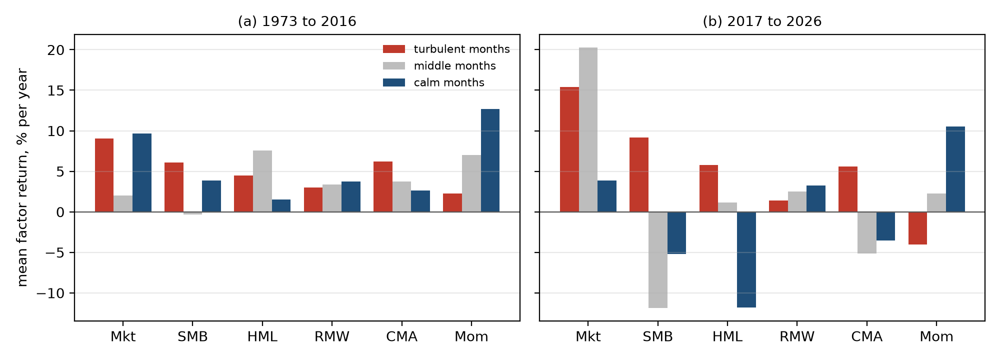
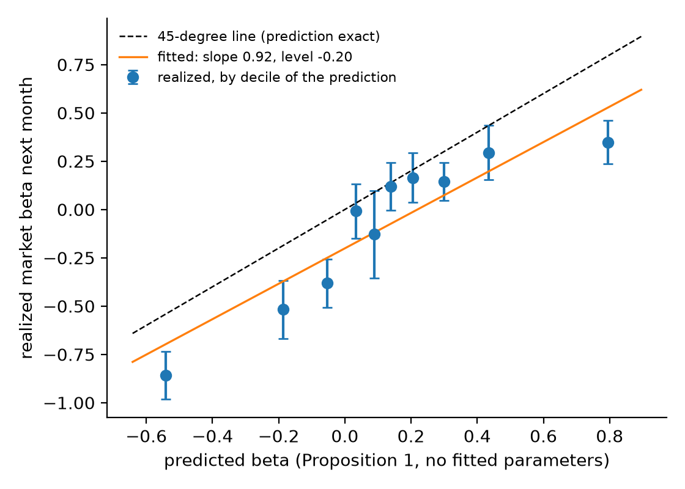

# Calm Months, Crash Months

**Why Volatility Management Pays for Momentum and Not the Market**

**Author:** Tanishk Yadav, New York University, Tandon School of Engineering\
**Status:** SSRN preprint [7113079](https://papers.ssrn.com/sol3/papers.cfm?abstract_id=7113079), September 2026. Not peer reviewed.\
**Paper, figures and summary:** [tanishkyadav.me/research/volatility-managed-factors](https://www.tanishkyadav.me/research/volatility-managed-factors)\
**Manuscript:** [`paper/letter.pdf`](paper/letter.pdf)



---

## Question

Moreira and Muir (2017) show that scaling a factor's exposure by the inverse of its recent variance raises the Sharpe ratio of many equity factors. Their test uses full-sample moments no investor had, and in real time most of the gains disappear (Cederburg, O'Doherty, Wang and Yan 2020). Momentum is the consistent survivor. Why momentum, and why not the market, for which the rule was first proposed?

## Key results

Real time: every position uses only data available at the end of the prior month, exposure is capped at 1.5, and every change in exposure costs 14 basis points. July 1973 to August 2026, 638 months.

| Factor | Sharpe, original | Sharpe, managed (net) | Holm-adjusted p | Largest loss at equal volatility, original / managed (pts) |
|---|---|---|---|---|
| **Momentum** | 0.43 | **0.94** | **0.023** | 76 / 23 |
| Market | 0.51 | 0.48 | 1.000 | 68 / 42 |
| Size (SMB) | 0.21 | 0.13 | 1.000 | 77 / 85 |
| Value (HML) | 0.32 | 0.27 | 1.000 | 79 / 67 |
| Profitability (RMW) | 0.38 | 0.45 | 1.000 | 51 / 46 |
| Investment (CMA) | 0.45 | 0.41 | 1.000 | 31 / 47 |

| Result | Value |
|---|---|
| Only momentum improves | No other factor's Sharpe ratio changes significantly, and no real-time combination of original and managed factor beats its original factor after costs |
| Robustness | Across variance signals, block lengths, caps, scaling rules and start dates, managed momentum's Sharpe ratio ranges from 0.78 to 0.97 and always differs from the original (p at most 0.014) |
| After the published samples end | Momentum 0.21 to 0.44 over 116 months, against 0.48 to 1.02 before; the change between the periods is not significant (p = 0.24) |
| Why only momentum | An exact decomposition: timing adds return only when a factor earns less in turbulent months. Momentum's covariance between exposure and return is positive; every other factor's is negative |
| Momentum's formation beta | Closed form from two cross-sectional quantities via Tweedie's formula. Tested on CRSP with no fitted parameter, 1932 to 2025: slope 0.92 (standard error 0.19), 79% of the explanatory power of an in-sample regression. The realized level sits 0.20 below the prediction, so a joint test of an exact prediction rejects |
| Where the gain comes from | Months after market declines are 29% of the sample and supply 71% of the covariance through which timing adds to momentum's return |
| No forecast needed | A mean forecast built from the predicted beta does not beat the historical mean (out-of-sample R² of -0.30% before 2017, Clark-West p = 0.15); the gain works through scaling exposure |
| The market | If its premium rises with its variance, an inverse-variance rule cuts exposure exactly when the premium rises, so the market should not be volatility-timed; its Sharpe ratio falls from 0.51 to 0.48 |

## Abstract

Built with only past data, capped leverage and trading costs, volatility management improves momentum, from a Sharpe ratio of 0.43 to 0.94 over July 1973 to August 2026, but none of the other Fama-French factors. We explain why. Sorting stocks on past returns loads momentum on the market in proportion to the market's own return over the formation window. Using Tweedie's formula, we derive this beta in closed form from two cross-sectional quantities, the dispersion of stock betas and the density of past returns at the portfolio breakpoints, and test it on CRSP with no fitted parameter. Against realized betas from 1932 to 2025, the prediction has a slope of 0.92 (standard error 0.19) and 79% of the explanatory power of an in-sample regression: it captures how momentum's beta moves, while the realized level sits 0.20 below the prediction. Months after market declines are 29% of the sample and supply 71% of the covariance through which timing adds to momentum's return. If the market's premium rises with its variance, the same logic implies that the market should not be volatility-timed; in our sample it is not improved by it.

**Keywords:** volatility-managed portfolios, momentum, time-varying beta, Tweedie's formula, factor timing\
**JEL:** G11, G12, G14



## Data

- **Factors:** market, size, value, profitability, investment and momentum from the Kenneth R. French Data Library, July 1963 to August 2026. Monthly returns come from the monthly files; daily returns serve only to measure risk. No API key needed.
- **Stocks:** CRSP common stocks on NYSE, AMEX and NASDAQ through WRDS, monthly, to December 2025, for the formation-beta test. Stock-level CRSP data are licensed: they are cached under `data/crsp/` (gitignored) and never committed. Only portfolio-level series and test statistics are written to `output/mechanism/`. The rebuilt value-weighted momentum factor correlates 0.9989 with French's over 1,181 months.

## Methods

1. **Real-time rebuild.** The variance signal is an exponentially weighted average of squared daily returns with a one-month half-life; the scale constant is estimated on an expanding window with a 120-month burn-in; exposure is capped at 1.5 and charged 14 basis points per unit of change. Moreira and Muir's prior-month realized variance is reported alongside.
2. **Inference.** Sharpe ratios are compared with the studentized circular block bootstrap of Ledoit and Wolf (2008), 12-month blocks, 4,999 resamples, Holm-adjusted across the six factors.
3. **Pre-registration.** The learning rate was chosen for momentum on 1973 to 2016 data among 24 variants fixed in advance (`paper/PLAN_adaptive.md`). The CRSP test was specified before the data were downloaded, and every later test before it was run (`paper/PLAN_mechanism.md`).
4. **Formation-beta test.** Stock betas are estimated over months m-71 to m-12, before the formation window starts. The cross-sectional beta variance is corrected for estimation error, and the density of formation returns at the NYSE breakpoints uses the quantile-spacing estimator with the Hall-Sheather bandwidth. The test regresses momentum on the predicted beta times the market return, with Newey-West errors (12 lags).
5. **No lookahead.** Tests replace every return and variance dated at or after a cut-off with noise and check that every earlier position is unchanged.

## Reproducing

```bash
python -m venv .venv && source .venv/bin/activate
pip install -r requirements.txt

python src/realtime.py                 # real-time rebuild of the six factors, tables and numbers
python src/adaptive.py                 # pre-registered learning-rate grid and selection rules
pip install wrds                       # only for the CRSP pull; needs a WRDS entry in ~/.pgpass
python src/crsp_mechanism.py pull      # stock-level CRSP, cached in data/crsp/ (gitignored)
python src/crsp_mechanism.py run       # formation-beta test, portfolio-level output only
python src/mechanism_paper.py          # mechanism numbers, table and figures
pytest tests/                          # no-lookahead invariance and mechanism checks
cd paper && pdflatex letter.tex
```

Numbers land in `paper/generated/` and `output/`; the manuscript reads them directly, so no figure in the text is typed by hand.

## Repository

```
src/realtime.py              real-time volatility management, six factors
src/adaptive.py              learning-rate variants (pre-registered)
src/crsp_mechanism.py        CRSP formation-beta test
src/mechanism_paper.py       mechanism section numbers and figures
src/vol_managed_factors.py   in-sample Moreira-Muir spanning regressions; it uses French's daily momentum
                             file, which is re-formed daily, so its momentum row is not the monthly factor
tests/                       no-lookahead and mechanism tests
paper/letter.tex, .pdf       manuscript
paper/PLAN_*.md, REVIEW.md   pre-registration plans and the review log
paper/submission/            journal submission package
*.ipynb                      sector factor attribution, sector-momentum baseline, rolling betas
```

## Cite

Yadav, Tanishk (2026). "Calm Months, Crash Months: Why Volatility Management Pays for Momentum and Not the Market." SSRN preprint 7113079. https://ssrn.com/abstract=7113079

## References

- Moreira, A., Muir, T. (2017). Volatility-managed portfolios. *Journal of Finance* 72(4), 1611-1644.
- Cederburg, S., O'Doherty, M.S., Wang, F., Yan, X.S. (2020). On the performance of volatility-managed portfolios. *Journal of Financial Economics* 138(1), 95-117.
- Barroso, P., Santa-Clara, P. (2015). Momentum has its moments. *Journal of Financial Economics* 116(1), 111-120.
- Daniel, K., Moskowitz, T.J. (2016). Momentum crashes. *Journal of Financial Economics* 122(2), 221-247.
- Grundy, B.D., Martin, J.S. (2001). Understanding the nature of the risks and the source of the rewards to momentum investing. *Review of Financial Studies* 14(1), 29-78.

*Data: Kenneth R. French Data Library; CRSP through WRDS. Research project, not investment advice.*
